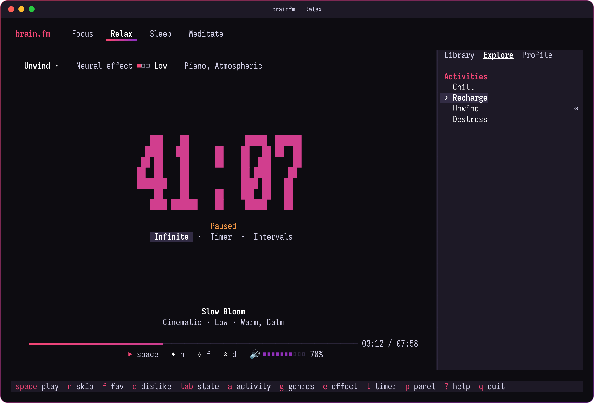

<div align="center">

# brainfm

**Brain.fm focus music, right in your terminal.**

A desktop-style TUI and a scriptable CLI for [Brain.fm](https://www.brain.fm),
written in Rust. No browser, no Electron, no external player.

[](https://github.com/dynamotn/brainfm-tui/actions/workflows/ci.yml)
[](https://github.com/dynamotn/brainfm-tui/releases)
[](LICENSE)
[](https://www.rust-lang.org)


</div>

## Why

- **Feels like the desktop app.** Same layout: mental-state tabs, a big
  session timer, the track card, and a Library / Explore / Profile panel, in
  Brain.fm's own colours.
- **Built for deep work.** Infinite, countdown or Pomodoro-style intervals
  with a chime at each switch. Music pauses for breaks and fades out when the
  session ends.
- **Never runs dry.** The next track is fetched 20 seconds before the current
  one ends, so playback continues without a gap.
- **Your filters, per state.** Activity, genres and neural effect level are
  remembered separately for Focus, Relax, Sleep and Meditate.
- **Plays nicely with your desktop.** Media keys and `playerctl` work through
  MPRIS.
- **Scriptable.** `brainfm play focus --intervals 25m/5m` runs a headless
  session from a shell, a status bar or a cron job.
- **Light and private.** One small binary. Audio streams into memory and is
  never written to disk. Only the session token is stored, never your
  password.

## Screenshots

<table>
  <tr>
    <td width="50%"></td>
    <td width="50%"></td>
  </tr>
  <tr>
    <td align="center"><sub>Pick genres, activity and neural effect from popovers</sub></td>
    <td align="center"><sub>Relax session with the Explore tab</sub></td>
  </tr>
  <tr>
    <td colspan="2" align="center"></td>
  </tr>
  <tr>
    <td colspan="2" align="center"><sub>Still usable at 80×24: the side panel tucks away on narrow terminals</sub></td>
  </tr>
</table>

<sub>The screenshots are rendered from sample data by the app's real UI code
(`scripts/screenshots.sh`). Track names are made up.</sub>

## Quick start

```sh
brainfm login     # once
brainfm           # open the player, press space
```

## Install

### Prebuilt binaries

Download the archive for your platform from
[Releases](https://github.com/dynamotn/brainfm-tui/releases): Linux x86_64 or
aarch64, or macOS on Apple Silicon. Then verify and unpack it:

```sh
sha256sum -c SHA256SUMS --ignore-missing
tar -xzf brainfm-v*-x86_64-unknown-linux-gnu.tar.gz
```

On Linux the binary needs `libasound.so.2` and `libdbus-1.so.3`, which most
desktops already have.

### From source

You need Rust 1.91 or newer. On Linux you also need the ALSA and D-Bus
headers: `alsa-lib dbus` on Arch, `libasound2-dev libdbus-1-dev` on
Debian/Ubuntu.

```sh
cargo install --git https://github.com/dynamotn/brainfm-tui
```

## Log in

```sh
brainfm login            # email + password
brainfm login --token    # paste a token instead
brainfm whoami
brainfm logout
```

If you sign in to Brain.fm with Google or Apple, use `--token`:

1. Open my.brain.fm and your browser's DevTools.
2. Copy the `Authorization: Bearer …` value from any request to
   `api.brain.fm`.
3. Paste it at the prompt.

The token is stored with mode `0600`. Brain.fm refreshes it on every request,
and brainfm keeps the stored copy up to date.

## Using the player

Run `brainfm` with no arguments. Press `?` at any time for the key list.

<details>
<summary><b>Keys</b></summary>

| Key | Action |
|---|---|
| `space` | play / pause |
| `n` | skip track |
| `f` | favorite / unfavorite |
| `d` | dislike (never play again) and skip |
| `tab` / `shift-tab` / `1`–`4` | switch mental state |
| `a` | pick activity |
| `g` | pick genres (none selected means all) |
| `e` | pick neural effect level |
| `t` | timer: Infinite, 30 min / 1 hr / 2 hrs, custom, Intervals |
| `+` / `-` | volume |
| `p` | show / hide the side panel |
| `[` / `]` | switch panel tab |
| `j` / `k`, `enter` | move and select in the panel and pickers |
| `q` / `ctrl-c` | quit |

</details>

Without truecolor support the TUI falls back to 256 colours. Set
`BRAINFM_ASCII=1` if your font lacks the symbols.

## Scripting

```sh
brainfm list states
brainfm list activities --state focus
brainfm list genres --state relax

brainfm play focus
brainfm play focus --activity "Deep Work" --effect high --intervals 25m/5m
brainfm play sleep --genre Piano --timer 1h30m
```

`play` shows a one-line status, chimes between intervals, and fades out when
the timer ends or when you press Ctrl-C.

<details>
<summary><b>Where brainfm keeps its files</b></summary>

| What | Where (Linux) |
|---|---|
| Session token | `~/.local/state/brainfm/session.json` |
| Preferences | `~/.config/brainfm/config.toml` |
| Log | `~/.local/state/brainfm/brainfm.log` |

</details>

## Development

```sh
cargo test                                    # unit, API (wiremock) and UI snapshot tests
cargo test --test player_smoke -- --ignored   # real audio; needs ffmpeg and a sound card
prek run --all-files                          # fmt, clippy, tests
cargo deny check                              # advisories, licenses, sources
scripts/screenshots.sh                        # regenerate docs/screenshots
```

The compiler is pinned in `rust-toolchain.toml`, so local checks match CI.

To release, bump `version` in `Cargo.toml`, commit, and push a matching tag
(`git tag v0.2.0 && git push origin v0.2.0`). The Release workflow runs CI,
checks the tag against `Cargo.toml`, and publishes binaries with checksums.

## Disclaimer

This is an unofficial client: Brain.fm has not made, endorsed or supported
it. It talks to the same private API as the web app, so a change on their side
can break it. You need a Brain.fm subscription. Use it at your own risk and
within [Brain.fm's Terms](https://www.brain.fm/terms).

## License

[MIT](LICENSE). Brain.fm is a trademark of its owner.
