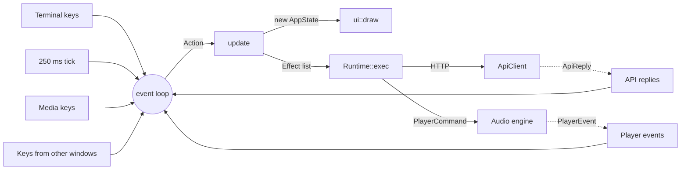
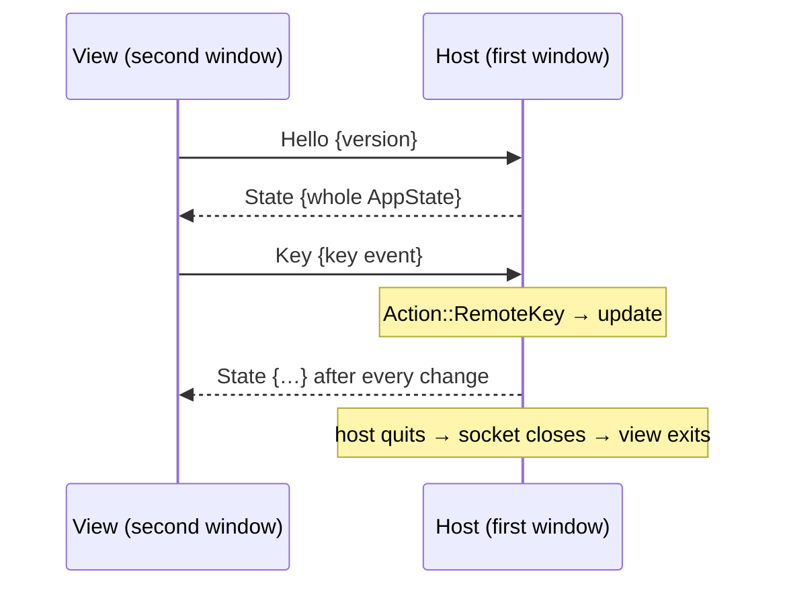

# Architecture

brainfm is a single Rust binary. The library target (`src/lib.rs`) exists so
integration tests can reach the internals; only what `main.rs` and `tests/`
use is public.

## Map

| Module | Responsibility |
|---|---|
| `main.rs`, `cli.rs` | Argument parsing, the `login`/`logout`/`whoami`/`list` commands, exit codes. |
| `api/` | Typed client for `api.brain.fm`: requests, response envelopes, errors. |
| `session.rs`, `secret.rs` | The stored token, and a string type for passwords that never prints. |
| `config.rs` | `config.toml`: loading, atomic and debounced saving. |
| `app/` | The TUI: state, reducer, event loop, and the view used by extra windows. |
| `ui/` | Drawing `AppState` with ratatui; snapshot tests and screenshot rendering. |
| `player/` | The audio engine thread: streaming, decoding, gapless queueing. |
| `timer.rs` | Infinite, countdown and interval timers. |
| `media/` | Desktop media controls: an MPRIS server on Linux, Now Playing on macOS. |
| `share/` | The Unix socket that lets several windows share one session. |
| `headless/` | `brainfm play`: a state machine plus the loop that runs it. |

## The TUI: state, actions, effects

The TUI follows one rule: **`app::update` is a pure function.** It takes the
current `AppState` and one `Action`, changes the state, and returns a list of
`Effect`s describing the I/O to do. It never touches the network, the
terminal, the clock or the audio device. Almost all behaviour is therefore
testable with plain unit tests (`src/app/tests.rs`).

`app::run` owns the loop. Each turn it:

1. draws the current state;
2. waits for the next action;
3. runs `update` and executes the returned effects;
4. publishes the state to other windows and the media controls.

Effects that call the API run as tokio tasks and report back as
`Action::Api(...)`.

### Requests that can go stale

Several things can be in flight at once: a skip, a prefetch, a track the
engine is still opening. Two counters keep late answers from undoing newer
ones:

- `session_gen` is bumped by every session request. A reply or failure with
  an older generation is ignored.
- A track sent to the engine waits in `pending` until the engine reports
  `Started`; only then does it become `now`. Events about any other track are
  ignored.

When a request fails, playback returns to what the engine is still doing
(`resume_to`), so the screen never claims to be playing silence. A watchdog
gives up on `Loading` after 30 seconds.

## The audio engine

`player::spawn` starts a dedicated thread that owns the output device and a
rodio `Player`. The rest of the program talks to it through `PlayerCommand`s
(`Load`, `Queue`, `Play`, `Pause`, `Stop`, `SetVolume`, `Chime`,
`CancelPending`) and hears back through `PlayerEvent`s (`Started`,
`Position`, `NearEnd`, `Ended`, `Error`).

- **Streaming.** stream-download fetches the track into memory while it
  plays, so nothing is written to disk. Opening a stream can stall on the
  network, so it runs on tokio's blocking pool. The source comes back tagged
  with a generation, and anything superseded meanwhile is dropped.
- **Gapless.** 20 seconds before a track ends the engine sends `NearEnd`, the
  app fetches the next track, and `Queue` appends it to the same rodio queue.
- **Output.** cpal's default host prefers native PipeWire (when built with
  the `pipewire` feature), then PulseAudio, then ALSA. `BRAINFM_AUDIO_HOST`
  overrides it (`player::choose_host`).
- **Shutdown.** Dropping the last `PlayerHandle` stops the thread and closes
  the device.

## The API client

`api::ApiClient` mirrors what the web app sends:

- the same `Origin` and `Referer` headers;
- version 2 or 3 paths, as the web app uses them;
- a bearer token.

Every response is a `{status, result, messages, token}` envelope. A new
`token` replaces the stored one, which slides the session forward. Ids are
checked against `[A-Za-z0-9_-]` before they go into a URL path.

`ApiError` is the only typed error in the crate, because callers branch on
it: an expired session opens the login form, while other errors show a
message. Everything else uses `anyhow` with context.

## Several windows: `share/`

The first `brainfm` binds `$XDG_RUNTIME_DIR/brainfm/tui.sock` and becomes the
**host**. A later window connects and becomes a **view**.

- The protocol is one JSON object per line.
- The host publishes the serialized state through a `watch` channel, so a
  slow view only ever receives the latest state.
- Views draw that state with the same `ui::draw`, at their own terminal size.
- Remote keys arrive as `Action::RemoteKey`. The reducer ignores quit keys
  from them, so a view can close itself but never the host.
- The password typed into a login form crosses the socket only as a mask of
  the same length (`Secret`'s serializer).
- `brainfm play` holds the socket as well and answers every view with
  `Busy`, so the TUI and the command line never play two streams.

## Media controls: `media/`

`media::Media` has the same async API on every platform: `start`,
`set_track`, `set_playback`, `set_position`, `set_volume`. Commands come back
as `MediaKey`s. `Mirror` remembers what was last pushed and sends only
changes. It keys tracks on (id, play count), so the same track played twice
still counts as a change.

On Linux, `media::mpris` is an MPRIS 2 server written with zbus.

- **Bus name.** It asks for `org.mpris.MediaPlayer2.brainfm` without
  replacing or queueing. If that name is taken, it falls back to
  `…brainfm.instance<pid>`.
- **Track ids.** Each track gets an object path under
  `/io/github/dynamotn/brainfm/track/`.
- **Position.** It is not signalled. Clients poll it, and the server
  interpolates from the last engine report.
- **Capabilities.** The `Can*` properties reflect what actually works: no
  previous, no seek.

## `brainfm play`: `headless/`

The command-line player has the same shape as the TUI, on a smaller scale.

- `headless::machine::Machine` holds the session. It takes events (player
  events, fetch results, media keys, ticks) and returns `Cmd`s.
- `headless::play` runs a `select!` loop that carries those out.

Track fetches run in the background and are tagged with an epoch. A skip, or
a reload after an error or a natural end, bumps the epoch, so late fetches
are dropped. Two independent flags in `Pauses` decide silence: a user pause,
and an interval break. The timer runs except during a user pause.

## Security notes

- The token is stored with mode `0600` in a `0700` directory.
- The password is never stored. It lives in a `Secret`, which never appears
  in `Debug` output and is zeroized on drop.
- Signed audio URLs carry short-lived credentials in their query strings.
  Error messages cut those query strings off (`player::redact_urls`), and
  stream-download's own logging is switched off.
- Text from the API is stripped of control characters before it is printed by
  the command line. The TUI draws through ratatui, which drops them anyway.
- Audio is fetched over HTTPS only.
