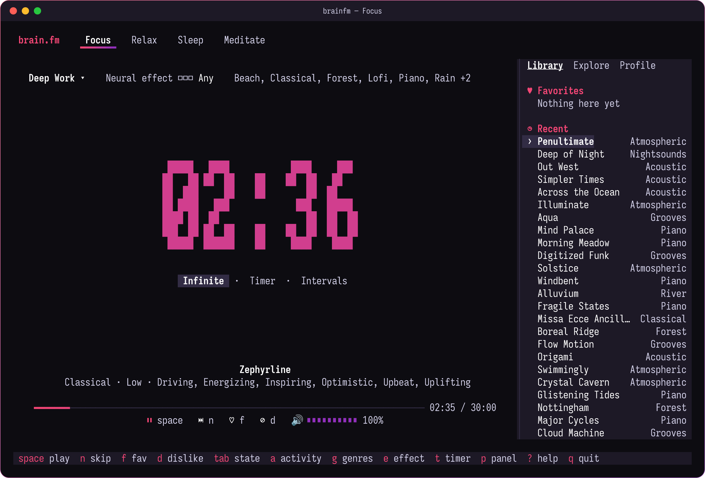
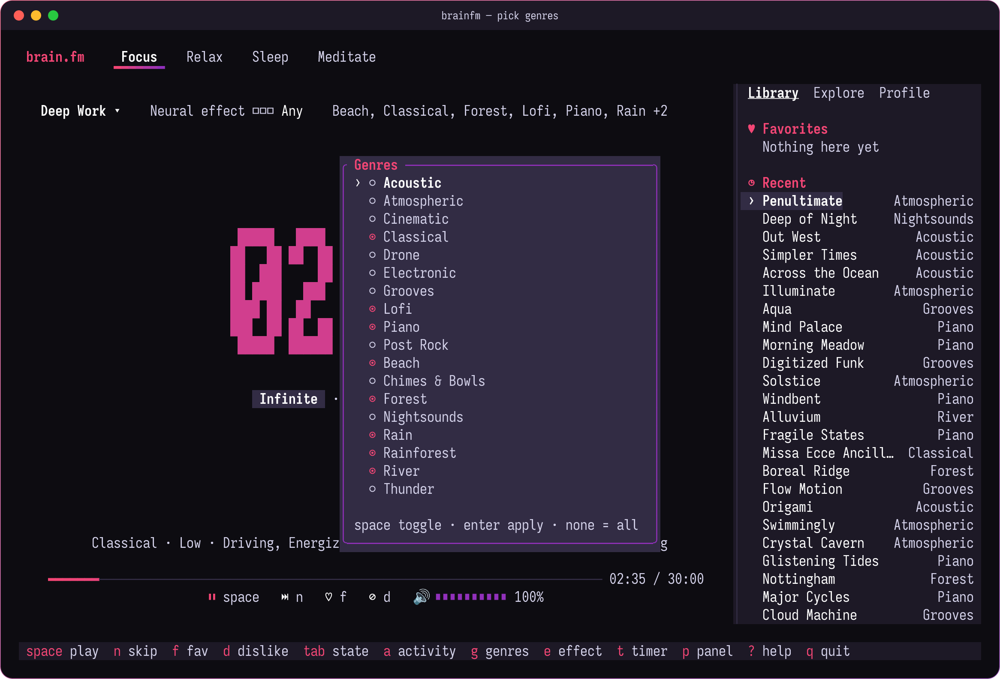
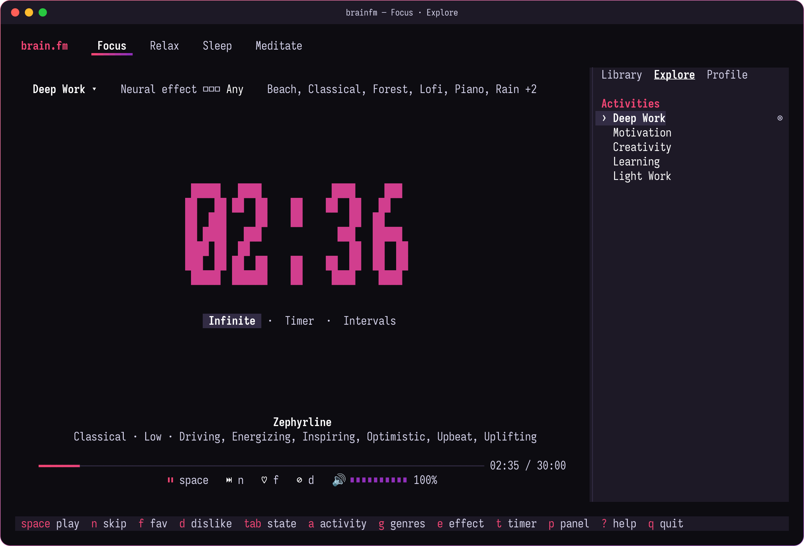
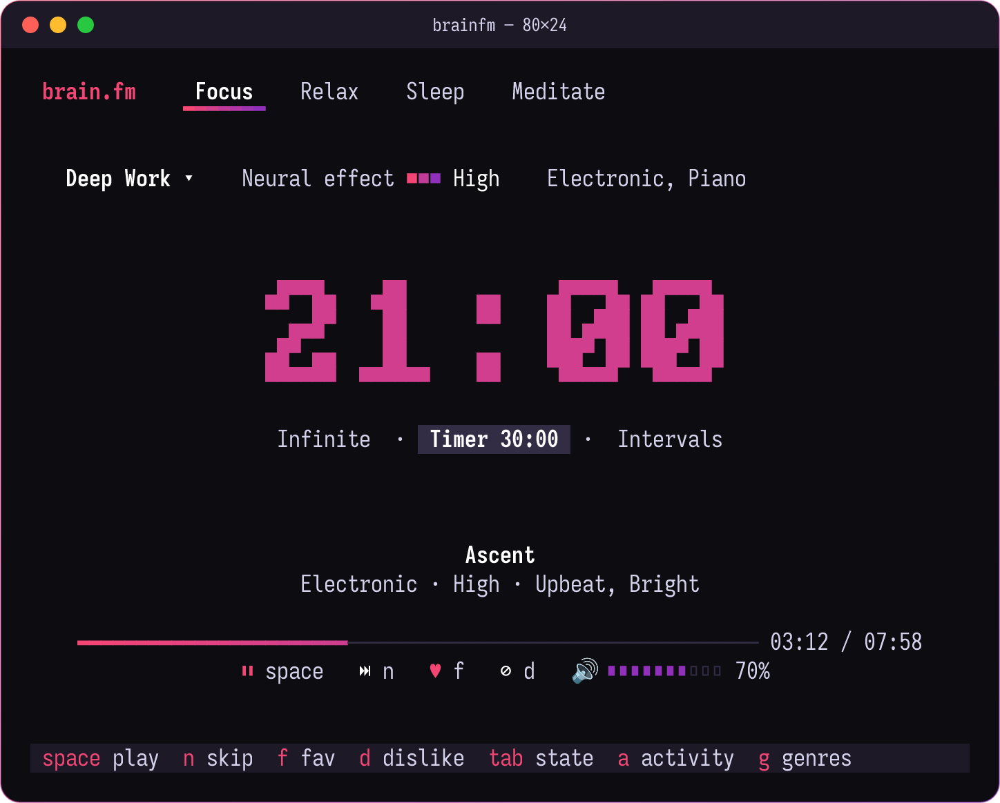

# User guide

This guide covers everything you can do with brainfm, from the first login to
running it from scripts. The [configuration reference](configuration.md) lists
every file and setting.

- [Before you start](#before-you-start)
- [Logging in](#logging-in)
- [The player](#the-player)
- [Choosing what plays](#choosing-what-plays)
- [Timers](#timers)
- [Library, Explore and Profile](#library-explore-and-profile)
- [Background playback and several windows](#background-playback-and-several-windows)
- [Media keys and desktop widgets](#media-keys-and-desktop-widgets)
- [Sound output](#sound-output)
- [Playing from the command line](#playing-from-the-command-line)
- [Troubleshooting](#troubleshooting)
- [Limitations](#limitations)

## Before you start

You need a Brain.fm subscription and a terminal at least 60 columns wide and
20 rows tall. At 100 columns or wider, the side panel appears next to the
player.

Colours look best in a terminal with truecolor support (most modern ones; it
is detected through `COLORTERM`). Other terminals get a 256-colour version of
the same palette.

## Logging in

```sh
brainfm login
```

brainfm asks for your email and password, logs in, and stores only the
session token that Brain.fm returns. Your password is never written to disk.

If you sign in to Brain.fm with Google or Apple, you have no password to type.
Copy a token from the web app instead:

1. Open [my.brain.fm](https://my.brain.fm) and sign in.
2. Open your browser's developer tools and the Network tab.
3. Click any request to `api.brain.fm`, and copy the value after
   `Authorization: Bearer`.
4. Run `brainfm login --token` and paste it. Input is hidden.

The token is checked before it is saved. Brain.fm refreshes it on every
request, and brainfm keeps the stored copy current, so you only log in again
after a long break.

You can also log in from inside the player: if no session is stored, `brainfm`
opens a login form. Press `tab` to move between fields and `enter` to submit.

Other account commands:

```sh
brainfm whoami    # user id, email and name
brainfm logout    # stop the music, then forget the stored token
```

## The player

Run `brainfm` and press `space`.



| Area | What it shows |
|---|---|
| Top bar | The four mental states. The underlined one is active. |
| Filter line | The activity, the neural effect level and the genres the next track is picked from. |
| Big clock | The session timer: time elapsed, or time left. |
| Chips | The timer mode: Infinite, Timer or Intervals. |
| Track card | Title, then genre, neural effect level and moods. |
| Progress bar | Position in the current track. |
| Controls | Play state, favourite heart and volume. |
| Footer | The most useful keys for your terminal width. |

Messages such as "No tracks match these filters" appear as a short banner
above the footer.

### Keys

| Key | Action |
|---|---|
| `space` | Play or pause. From a stopped state, starts a session. |
| `n` | Skip to a new track. |
| `f` | Add the track to favourites, or remove it. |
| `d` | Dislike the track: Brain.fm never plays it again, and it is skipped. |
| `tab`, `shift-tab`, `1`–`4` | Switch mental state. |
| `a` | Pick the activity. |
| `g` | Pick genres. |
| `e` | Pick the neural effect level. |
| `t` | Pick a timer. |
| `+`, `-` | Volume up or down by 10%. |
| `p` | Show or hide the side panel. |
| `[`, `]` | Previous or next panel tab. |
| `j`/`k` or arrows, `enter` | Move and select in the panel and in pickers. |
| `esc` | Close a picker. |
| `?` | Show all keys. |
| `q`, `ctrl-c` | Close this window. The music keeps playing in the background. |
| `Q` | Stop the music and quit. |
| `L` | Log in again, when the banner says the session expired. |

Tracks continue on their own: the next one is fetched 20 seconds before the
current one ends, so there is no gap between them.

## Choosing what plays

Each mental state (Focus, Relax, Sleep, Meditate) remembers its own filters,
the way the desktop app does.

- **Activity** (`a`): what you are doing, such as Deep Work or Learning. Each
  state has its own list, loaded from Brain.fm.
- **Genres** (`g`): tick any number with `space`, then press `enter`. With
  none ticked, all genres are allowed.
- **Neural effect** (`e`): Low, Medium or High, or several. With none ticked,
  any level is allowed.



Changing a filter while music plays starts a new track that matches it.
Switching state works the same way. If the new state's activities are still
loading, playback restarts as soon as they arrive.

## Timers

Press `t` to choose:

| Mode | Behaviour |
|---|---|
| Infinite | The clock counts up. Music plays until you stop it. |
| 30 min, 1 hr, 2 hrs | The clock counts down; at zero the music fades out over three seconds. |
| Custom lengths | Up to three lengths of your own, set in the [configuration](configuration.md#timer). |
| Intervals | Work and break blocks, 25 and 5 minutes by default. A chime marks each switch, and music pauses for the break. |

Pausing pauses the clock too. A break keeps counting even while music is
paused.

## Library, Explore and Profile

The side panel mirrors the desktop app's.

- **Library** lists your favourites, then recently played tracks. Select one
  and press `enter` to play it.
- **Explore** lists the activities of the current state; `enter` picks one.
- **Profile** shows the account and where the configuration lives.



The panel needs a terminal at least 100 columns wide; below that the player
uses the whole width. On wider terminals `p` hides or shows it.



## Background playback and several windows

The first `brainfm` you open starts a background process, `brainfm daemon`,
which plays the music and holds the session. The window is only a view of it.
Close the window and the music keeps playing; open `brainfm` again, in this
terminal or another, and it shows the same track, timer, filters and popups.
Only one audio stream ever plays.

- Any window can control the session, and any number can be open at once.
- `q` or `ctrl-c` closes only the window you press it in.
- `Q` stops the music and the background process.
- The daemon exits on its own after 10 minutes with no window open and
  nothing playing. A running timer counts as playing.
- To stop it from a shell, run `brainfm stop`. It prints nothing and exits 0
  when nothing is running, and it also stops a `brainfm play` session.
- If a window finds a daemon of another version, it exits and asks you to run
  `brainfm stop`; start `brainfm` again afterwards.

If the session expires, the footer says so. Press `L` in any window to log in
again; the background process picks up the new login and the banner clears in
every window. You type the password in your own window and it never crosses the
socket. If you log in from another window first, the form stays open and says
"Logged in from another window — press Esc". `brainfm login` in a shell also
tells a running daemon to use the new token, and `brainfm logout` stops it
first.

Windows find the daemon through a socket in `$XDG_RUNTIME_DIR/brainfm/`. A
`brainfm play` session holds it too, so the TUI and the command line never
play at the same time. `brainfm play` stops a daemon that is paused or idle
and takes its place; while the daemon is playing, it refuses and asks you to
run `brainfm stop` first. A TUI started during `brainfm play` explains why it
cannot open. The
daemon and `brainfm stop` need Unix; elsewhere the TUI plays in its own
process and stops when you quit. If the daemon fails to start or stops
unexpectedly, the reason is in the log.

## Media keys and desktop widgets

On Linux, brainfm registers as an MPRIS player called `brainfm`. Desktop
media widgets show the track, cover art and progress, and media keys and
`playerctl` control it, both in the TUI and in `brainfm play`.

```sh
playerctl -p brainfm play-pause
playerctl -p brainfm next
playerctl -p brainfm metadata --format '{{ title }} · {{ album }}'
playerctl -p brainfm volume 0.4
```

| Supported | Not supported |
|---|---|
| Play, pause, play-pause, stop, next | Previous, seek, set position |
| Reading and setting the volume | Opening URIs, raise, quit |
| Title, genre (as album), length, cover art | Loop and shuffle |
| Playback position | |

Each track has its own MPRIS track id, so widgets notice every change, even
when the same track plays twice in a row.

On macOS, brainfm uses the system Now Playing controls instead. That backend
is built in CI but has not yet been tried on a real Mac. To receive its
commands, the background process runs the main thread's run loop.

## Sound output

brainfm plays through the first sound system that answers:

1. PipeWire, natively, in builds made with `--features pipewire`.
2. PulseAudio. On PipeWire desktops this goes through `pipewire-pulse`.
3. ALSA.

To pick one yourself, set `BRAINFM_AUDIO_HOST` to `pipewire`, `pulse` or
`alsa`. An unknown name is an error that lists the available choices. The log
records which one was used.

Audio streams into memory and is never written to disk.

## Playing from the command line

`brainfm play` runs a session without the TUI. It shows one status line,
chimes between intervals, fades out when the timer ends or when you press
`ctrl-c`, and answers media keys like the TUI.

```sh
brainfm play focus
brainfm play focus --activity "Deep Work" --effect high --intervals 25m/5m
brainfm play sleep --genre Piano --genre Rain --timer 1h30m
```

| Option | Meaning |
|---|---|
| `<STATE>` | `focus`, `relax`, `sleep` or `meditate`, or a state id. |
| `--activity NAME` | Activity by name or id. Defaults to your saved choice, then the state's default. |
| `--effect LEVEL` | `low`, `medium` or `high`. Defaults to your saved choice. |
| `--genre NAME` | A genre to allow; repeat for more. Defaults to your saved choice. |
| `--timer LENGTH` | Stop after `25m`, `1h30m` and so on. |
| `--intervals WORK/BREAK` | Work and break blocks, such as `25m/5m`. |

To find valid names:

```sh
brainfm list states
brainfm list activities --state relax
brainfm list genres --state focus
```

Exit status is 0 on a normal end, 2 when the session has expired (run
`brainfm login`), and 1 for any other error.

## Troubleshooting

**"Session expired — run `brainfm login`"**: the stored token is no longer
valid. Log in again. In the TUI a banner says so; press `L` to log in.

**"No tracks match these filters"**: the activity, genres and effect level
together leave nothing to play. Allow more genres or levels.

**"Terminal too small"**: make the window at least 60 by 20.

**No sound, or the wrong device**: run `brainfm stop`, then check the sound
system with `BRAINFM_AUDIO_HOST=alsa brainfm` and with `pulse`, and see which
one the log reports. On a desktop with neither PulseAudio nor PipeWire, only ALSA is
available.

**An environment variable has no effect**: the background player reads
`BRAINFM_AUDIO_HOST` and the rest of its environment once, when it starts,
not each time a window opens. Run `brainfm stop`, then start `brainfm` again
with the new value.

**"brainfm daemon did not start"**: the background player failed while
starting, for example because there is no audio device or the audio host is
unknown. The message quotes the reason when it can; the full error is in
`brainfm.log` in the state directory.

**Symbols show as boxes**: set `BRAINFM_ASCII=1` to use plain characters.

**Anything else**: the log is at `~/.local/state/brainfm/brainfm.log`. It
never contains your password or token, and audio URLs in it are cut short.

## Limitations

- brainfm uses the same private API as the Brain.fm web app. A change on
  Brain.fm's side can break it until brainfm is updated.
- Previous and seek are not available: Brain.fm generates a fresh track each
  time rather than playing a fixed playlist.
- In PulseAudio and PipeWire mixers the stream is labelled
  `cpal-pulseaudio-<pid>`; the audio library chooses that name.
- Windows builds are not provided.
